  

  
  
  
  

---

## Sobre mí

Soy tecnólogo en Desarrollo de Software. Antes de dedicarme de lleno a programar pasé 3 años en soporte técnico y atención al cliente, y eso marca cómo construyo: empiezo por entender lo que necesita el usuario real, no solo lo que el código permite.

Estoy disponible para un **empleo junior o proyectos freelance**.

## Proyectos

Todos tienen demo en línea. En los proyectos Laravel hay cuentas de prueba para entrar con cada rol.

<table>
  <tr>
    <td width="50%" valign="top">
      
      <h3>EliCrochet · e-commerce</h3>
      
Tienda en línea para una microempresa de artesanías: carrito, pagos con PayPhone, pedidos personalizados por cotización y panel con reportes financieros. Cada pago se procesa en una transacción atómica.

      
<code>Laravel</code> <code>MySQL</code> <code>Bootstrap</code> <code>Pest</code> <code>CI · 81% cobertura</code>

      

        <a href="https://elicrochet-demo.onrender.com"><b>Demo</b></a> ·
        <a href="https://github.com/LeandroRubio-73456/elicrochet-ecommerce">Código</a> ·
        <a href="https://leandrorubio-73456.github.io/portafolio/proyectos/elicrochet.html">Detalles</a>
      

    </td>
    <td width="50%" valign="top">
      
      <h3>Clínica veterinaria</h3>
      
Gestión de cirugías: agenda que impide cruces de veterinario y quirófano mediante transacciones con bloqueo, flujo de estados, portal para propietarios, reportes CSV/PDF y recordatorios automáticos.

      
<code>Laravel</code> <code>MySQL</code> <code>Tailwind</code> <code>Alpine.js</code> <code>Pest</code>

      

        <a href="https://clinica-veterinaria-demo.onrender.com"><b>Demo</b></a> ·
        <a href="https://github.com/LeandroRubio-73456/clinica-veterinaria">Código</a> ·
        <a href="https://leandrorubio-73456.github.io/portafolio/proyectos/clinica-veterinaria.html">Detalles</a>
      

    </td>
  </tr>
  <tr>
    <td width="50%" valign="top">
      
      <h3>Tecnosoluciones · landing</h3>
      
Sitio para un servicio técnico de Quito con una orden de servicio interactiva que arma el pedido y lo envía por WhatsApp.

      
<code>React</code> <code>Vite</code> <code>Tailwind</code>

      

        <a href="https://tecnosoluciones-5t8.pages.dev/"><b>Demo</b></a> ·
        <a href="https://github.com/LeandroRubio-73456/tecnosoluciones">Código</a> ·
        <a href="https://leandrorubio-73456.github.io/portafolio/proyectos/tecnosoluciones.html">Detalles</a>
      

    </td>
    <td width="50%" valign="top">
      
      <h3>Portafolio</h3>
      
Mi sitio personal con estética de terminal: proyectos con su contexto y decisiones técnicas, experiencia y CV. Sin JavaScript.

      
<code>HTML</code> <code>Tailwind CSS</code> <code>GitHub Pages</code>

      

        <a href="https://leandrorubio-73456.github.io/portafolio/"><b>Sitio</b></a> ·
        <a href="https://github.com/LeandroRubio-73456/portafolio">Código</a>
      

    </td>
  </tr>
</table>

> Las demos Laravel están en un plan gratuito: si nadie las usó en los últimos minutos, la primera carga puede tardar cerca de un minuto.

## Stack

  
  
  
  
  
  
  
  
  
  

## Cómo trabajo

- **Reglas de negocio protegidas en la base de datos:** transacciones y bloqueos para que dos usuarios no puedan reservar el mismo horario ni comprar la misma última unidad.
- **Pruebas automatizadas e integración continua:** en mis proyectos Laravel cada push ejecuta los tests en GitHub Actions; en el e-commerce, además, el formateo con Pint y el análisis de calidad con SonarCloud.
- **Demos reproducibles:** cada proyecto Laravel tiene una imagen Docker que levanta la app con datos de ejemplo, la misma que corre en la demo en línea.
- **Documentación pensada para quien llega después:** cada proyecto explica qué resuelve, cómo instalarlo y por qué se tomó cada decisión.
